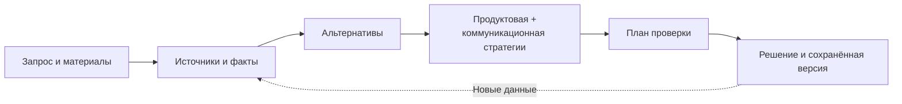

# Стратег Фабрики продуктов

**От неоднозначного запроса — к обоснованной продуктовой и коммуникационной стратегии.**

Это **файловый AI-агент** для руководителей цифровых продуктов: откройте репозиторий в coding assistant с доступом к файлам, задайте вопрос и пройдите структурированный процесс. Вместо разового ответа в чате сохраняется дело: источники, альтернативы, решение, продуктовая и коммуникационная стратегии, план проверки и история пересмотров. Это не отдельное приложение; модель, доступ к сайтам и инструменты зависят от выбранной среды.

*MGIMO AI Challenge · Трек МегаФона «Стратег Фабрики продуктов»*

[Быстрый старт](docs/quickstart.md) · [Мобильная демонстрация](docs/contest-demo.md) · [Описание для жюри](docs/submission-description.md) · [Архитектура](docs/architecture.md) · [Документация](docs/README.md)

---

## Зачем это нужно

«Почему падает удержание?», «Кому предложить новый сервис?», «Что обещать аудитории?» — такие вопросы требуют не красивого текста, а проверяемых оснований для выбора. Данные часто разрознены, определения метрик не согласованы, а срок ограничен.

Проект соединяет исследование и принятие решения в одном процессе:



## Возможности

| Этап | Что получаете |
|---|---|
| **Постановка задачи** | Цель, аудиторию, ограничения и вопросы, без которых решение преждевременно |
| **Исследование** | Источники с точными ссылками, подтверждения, противоречия и неизвестные |
| **Выбор направления** | Не менее трёх разных вариантов, включая статус-кво, сильные возражения и условную рекомендацию |
| **Стратегия** | Согласованные продуктовую ценность, аудиторию, обещание и каналы коммуникации |
| **Проверка** | Метрику, вариант сравнения, период, ограничения и условия пересмотра |
| **Продолжение работы** | Историю изменений, проверяемые версии решения и следующий шаг |

**Принцип:** важные утверждения должны иметь источник или быть явно помечены как гипотеза. Рекомендация не считается разрешением на публикацию, расходы или иное внешнее действие.

## Основная демонстрация: мобильная продуктовая стратегия

Учебный оператор выбирает, как помочь семьям и владельцам нескольких номеров. **R0001** сохраняет исследование и шесть альтернатив, **R0002** — выбор Product Owner в пользу ранней помощи семье через существующую передачу, **R0003** — ограниченный аудит и ослабление неподтверждённых выводов.

- Выбрано направление проверки, не реализация общего кабинета или разрешение пилота.
- При условных расходах 1 млн ₽ и прочем вкладе 0 для цели GP 285 млн ₽ от базы 279 млн ₽ нужны **14 000 дополнительных оплаченных номеро-месяцев** по учебной ставке 500 ₽; это не прогноз эффекта.
- Собственный прогноз по пяти KPI, реальная стоимость, ресурсы, сроки и окупаемость остаются **UNKNOWN**.
- История R0001–R0003 сохраняется; исходный receipt R0003 фиксирует `CHECKPOINTED`, не human acceptance или новую проверку release-копии.

[Разбор, источники и точный RESUME CASE](docs/contest-demo.md) · [Описание для жюри](docs/submission-description.md) · [Evidence среды и затрат](docs/release/demo-evidence.md)

**Публичный CASE:** [`cases/mobile-product-strategy-demo`](cases/mobile-product-strategy-demo/) — анонимизированный derivative с независимой D0001–D0003, выбран D0003 от исходного R0003. [EXPORT](cases/mobile-product-strategy-demo/EXPORT.md)/[карта hashes](cases/mobile-product-strategy-demo/export-map.json) отделяют упаковку от оригинала, который удержан локально (publication=hold), не изменён и не входит в PR.

**Ограничения:** показатели учебные; официальность неизменённого PDF UNKNOWN, права распространения требуют отдельной проверки. Исторические receipts/approvals не являются PASS или разрешениями на derivative. Это prepared walkthrough, не live-запуск и не подтверждённый бизнес-эффект.

**Дополнительный пример:** [PantryPath](docs/pantrypath-demo.md) — полностью синтетический сервис питания, альтернативы и три ревизии. Разница 22/48 против 18/48 (+8,3 п.п.) описательная, не доказанный эффект удержания.

## Быстрый старт

Нужны локальная копия проекта, coding assistant с файловыми инструментами и ваш доступ к модели. Для безопасного создания дела штатным helper нужен **Python 3.12+ и разрешённый запуск команд**, либо оператор, реально выполняющий команду и передающий receipt. Это не сервер, backend или launcher. Для checkpoint остаются обязательными существующие проверки `tools/case_protocol.py`; без них результат — DRAFT.

На Windows агент использует небольшой `tools/find_python.ps1`: ищет уже установленный runtime через поддерживаемые host-средства и проверяет реальные imports, не только `--version`. Установки Python и изменений системных настроек нет. Порядок запуска и операторский fallback — в [Quick Start](docs/quickstart.md).

1. Получите копию через **Git clone** или **Code → Download ZIP** на [странице проекта](https://github.com/EdYaRdx/megafon_hack) и откройте **корень проекта** в coding assistant.
2. Попросите прочитать `AGENTS.md` и [`prompts/first-run.md`](prompts/first-run.md), затем задайте свободный запрос: **«Помоги понять, почему падает удержание нашего сервиса»**. Заранее создавать папку или знать CASE path не нужно.
3. Агент кратко сформулирует задачу и предложит конкретный безопасный путь нового дела. **Подтвердите именно этот путь**. Только после согласия и реального успешного копирования шаблона агент зафиксирует CASE root и перейдёт к Intake. При занятом пути потребуется новое согласие на другой; при отсутствии инструментов/прав агент остановится и попросит операторскую помощь.

Для **RESUME / REVISE** явно укажите существующее `cases/<case-id>`; агент не ищет «последнее» дело. **HELP** объясняет начало работы без доступа к делам. Неоднозначный запрос вызывает уточнение, не создание. [Quick Start](docs/quickstart.md) содержит примеры ответов, операторские команды, checkpoint и продолжение. Автообнаружение инструкций и исполнение зависят от host; само открытие папки ничего не запускает.

## Документы, таблицы и сайты

Положите разрешённые материалы в `inputs/` внутри фактически выбранного дела и перечислите их в брифе: для документа — версию и раздел/страницу, для CSV — определения колонок, единицы и знаменатели, для сайта — точный URL и дату/версию условий. Попросите сохранять связь «источник → фрагмент → тезис → решение».

Чтение сайтов, PDF и XLSX зависит от host, не является встроенным сервисом проекта. Если формат или источник недоступен, предоставьте читаемый экспорт либо сохраните конкретный пробел; не выдавайте отсутствующее чтение или расчёт за выполненное. Не добавляйте credentials, закрытые материалы и персональные данные в папку агента.

## Как остановиться и продолжить

Перед паузой попросите сохранить решение, обе стратегии, обязательства и следующий шаг. Завершённое сохранение подтверждается настоящим **CHECKPOINTED**, а не заголовком в черновике: полный порядок gates — в [Quick Start](docs/quickstart.md).

В новом чате откройте ту же разрешённую папку и передайте **точный путь своего дела**, попросив сначала прочитать `AGENTS.md`, Skill `resume-revise` и проверить выбранный checkpoint. Агент восстанавливает задачу из файлов, не из старого чата. Готовые ревизии не переписываются; выполненные действия не повторяются, прежнее approval не переносится на изменённое основание.

После восстановления checkpoint агент отдельно ищет сохранённую незавершённую работу в выбранном деле. Подтверждённое решение и черновой анализ показываются раздельно. Можно продолжить выбранное дополнение, исключить его из текущего рассмотрения без удаления или уточнить задачу отдельно; при нескольких вариантах агент спрашивает выбор, а не назначает последний файл активным.


## Как устроен проект

Это **файловая архитектура**, а не отдельный веб-сервис. Правила работы, методика и данные конкретной задачи разделены.

```text
AGENTS.md                  Правила процесса
.agents/skills/            Шесть этапов работы
references/                Методика и работа с источниками
cases/_template/           Шаблон нового дела
cases/<case-id>/           Исходные материалы и результаты
  ├── brief.md             Постановка задачи
  ├── sources.jsonl        Источники
  ├── evidence.jsonl       Свидетельства
  ├── claims.jsonl         Тезисы и их основания
  ├── options.md           Альтернативы
  ├── decision.md          Рекомендация
  ├── strategy-product.md  Продуктовая стратегия
  ├── strategy-communication.md
  ├── test-plan.md         План проверки
  ├── state.md             Состояние задачи
  └── revisions/           Сохранённые версии
docs/                       Руководство и архитектура
```

Сохранённые ревизии связывают файлы и существенные зависимости контрольными суммами SHA-256. Источники и допущения можно проследить от решения до исходных материалов. При поступлении новых данных прежние версии не переписываются.

[Архитектура и жизненный цикл](docs/architecture.md) · [Шаблон и формат данных](cases/_template/README.md)

## Что остаётся после работы

Дело — это обычная папка, которую можно просмотреть или продолжить в другой сессии. В ней сохраняются бриф, исходные материалы, журналы источников/доказательств/тезисов, сравнение вариантов, решение, обе стратегии, план проверки и состояние. Завершённые ревизии сохраняют снимки и контрольные суммы зависимостей; новая версия добавляется отдельно.

## Документация

- [**Начало работы**](docs/quickstart.md) — первая задача и восстановление после паузы.
- [**Основная демонстрация**](docs/contest-demo.md) — мобильный кейс, варианты, стратегии, расчёты и R0001–R0003; [PantryPath](docs/pantrypath-demo.md) — дополнительный.
- [**Архитектура**](docs/architecture.md) — процессы, файлы, источники и сохранение состояния.
- [**Методика**](references/) — доказательства, метрики, безопасность работы с источниками.
- [**Документация проекта**](docs/README.md) — разработка, оценка, конкурсные материалы.

## Статус и ограничения

**Реализовано и показано в артефактах:** файловые инструкции и Skills, шаблон, проверяемые ревизии, публичный производный мобильный CASE D0001–D0003 и синтетический PantryPath. Оригинальная история R0001–R0003 остаётся локальной. Классификатор проверяет целостность файлов, не качество рекомендаций.

**Реализовано, но не подтверждено во всех средах:** следование инструкциям, обнаружение Skills, работа с сайтами и инструментами зависят от выбранного coding assistant и его настроек.

**Не поддерживается самим репозиторием:** отдельное приложение, встроенная модель, сервер, база данных, автоматическая маршрутизация моделей или фоновый мониторинг. Доступность интервью, обработки медиа и других инструментов зависит от среды и здесь не квалифицирована.

**Конкурсный RC:** текущие материалы и незакрытые условия — в [checklist](docs/submission-checklist.md), [описании для жюри](docs/submission-description.md) и [release verification](docs/release/contest-rc-verification.md). Новых продуктовых функций в этой версии не заявлено; подготовленные документы не означают запись видео, human acceptance или подачу.

Польза этой сборки — в сохранении оснований, вариантов и истории решения, а не в доказанном превосходстве рекомендаций над разовым ответом LLM. Синтетический пример не подтверждает качество на любой новой задаче, реальный спрос или эффект продукта. Существенные внешние действия требуют отдельного решения человека.

**Границы проверки:** совместимость файлов не доказывает качество стратегии или работу во всех средах. Подтверждённые результаты, оговорки восстановления и незакрытая человеческая приёмка собраны в [оценке](docs/evaluation.md); безусловный E2E PASS не заявлен.

[Что проверено и что пока неизвестно](docs/evaluation.md) · [Конкурсная подача](docs/submission-checklist.md)
