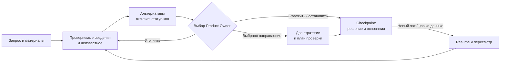

# Стратег Фабрики продуктов

**ИИ-агент, который превращает размытый продуктовый запрос в проверяемую рекомендацию — и сохраняет основания для следующего решения.**

Файловый проект для Codex, Cursor и совместимых coding assistants. Агент собирает разрешённые материалы, отделяет факты от гипотез, сравнивает альтернативы, помогает сформировать **продуктовую и коммуникационную стратегии**, планирует проверку и возобновляет работу из сохранённого дела. **Отдельного приложения, сервера и встроенной модели нет.**

*MGIMO AI Challenge · Трек МегаФона «Стратег Фабрики продуктов»*

[**Начать за несколько минут**](docs/quickstart.md) · [**Посмотреть реальный демонстрационный процесс**](docs/contest-demo.md) · [Архитектура](docs/architecture.md) · [Доказательства и ограничения](docs/evaluation.md) · [Навигация по документации](docs/README.md)

## От вопроса к решению

**Кто за что отвечает:** модель предлагает шаги, вопросы и выводы; **Product Owner** принимает существенные решения. Выбор направления не является разрешением на пилот, расходы, публикацию или контакт с клиентами. Сохранённый checkpoint — проверка целостности материалов, а не доказательство экономического эффекта.

## Быстрый старт

Нужны локальная копия репозитория, coding assistant с доступом к файлам и инструментам, доступ к модели; для штатного создания дела и проверки checkpoint нужен **Python 3.12+** и разрешённое выполнение команд (либо оператор, который выполнит их сам). Устанавливать сервер или поднимать Docker не нужно.

1. Откройте корень проекта в **Codex** или **Cursor**.
2. Попросите ассистента прочитать [`AGENTS.md`](AGENTS.md) и [`prompts/first-run.md`](prompts/first-run.md).
3. Напишите обычным языком, например: **«Пользователи бросают регистрацию. Помоги понять причины и выбрать, что улучшить».**
4. Агент предложит **конкретный путь нового дела**. Подтвердите его перед созданием файлов; дальше агент задаст только важные вопросы и начнёт работу.

Для продолжения в новом чате укажите точный путь существующего дела: `RESUME CASE cases/<case-id>`. Не используйте восстановление «последнего» дела по догадке. [Пошаговая инструкция, Windows/Python fallback и ошибки](docs/quickstart.md).

## Основная демонстрация: мобильный сервис

Мы проверяли агента на предоставленном для демонстрации **11-страничном примере брифа «Связь для близких и собственных устройств»** ([`Пример брифа.pdf`](cases/mobile-product-strategy-demo/inputs/Пример%20брифа.pdf)). Задача учебного оператора: сравнить помощь семьям и владельцам нескольких номеров, обосновать выбор, коммуникацию и экономику.

**Важно:** это пользовательский пример, связанный с конкурсной задачей, **но его статус как официальной версии брифа из личного кабинета организатора и права распространения независимо не подтверждены**. До конкурсной передачи их нужно проверить. Учебные числа не являются данными МегаФона.

| Этап работы | Что показывает |
|---|---|
| **Исследование** — исходная R0001 | Шесть альтернатив, источники, сильные возражения и неизвестное |
| **Выбор Product Owner** — R0002 | Приоритет узкой проактивной помощи семье, но не разрешение пилота |
| **Пересмотр после независимого аудита** — R0003 | Исправление допущений, сценарии достижимости и сохранение `UNKNOWN` |
| **Доступная для просмотра копия** — D0001 → D0003 | Обезличенный производный кейс с **отдельной** цепочкой SHA-256, не исходные ревизии |

[**Разбор сквозного кейса**](docs/contest-demo.md) · [Продуктовая стратегия](cases/mobile-product-strategy-demo/strategy-product.md) · [Коммуникационная стратегия](cases/mobile-product-strategy-demo/strategy-communication.md) · [Пятичастный документ](cases/mobile-product-strategy-demo/strategy.md) · [Происхождение копии](cases/mobile-product-strategy-demo/EXPORT.md)

**Пример проверяемой экономики:** разрыв 279 → 285 млн ₽ при условных прямых затратах 1 млн ₽, нулевых других вкладах и ставке 500 ₽ за оплаченный номеро-месяц требует **14 000 дополнительных оплаченных номеро-месяцев**. Это **условие достижения цели, не подтверждённый прогноз**. Неизвестны частота проблем, платёжный эффект, бюджет и ресурсы. [Допущения и проверка расчётов](docs/contest-demo.md#существенные-расчёты--с-единицами-и-границами).

## Что находится в репозитории

| Путь | Назначение |
|---|---|
| [`AGENTS.md`](AGENTS.md) | Общие правила поведения агента и границы полномочий |
| [`.agents/skills/`](.agents/skills/) | Шесть повторяемых процедур — от Intake до Resume |
| [`references/`](references/) | Методика источников, метрик и безопасности |
| [`cases/_template/`](cases/_template/) | Шаблон нового дела и протокол ревизий |
| [`cases/mobile-product-strategy-demo/`](cases/mobile-product-strategy-demo/) | Основной обезличенный демонстрационный кейс |
| [`tools/`](tools/) и [`tests/`](tests/) | CLI-проверки, deterministic расчёты, тесты |
| [`docs/`](docs/README.md) | Руководства, архитектура, оценка и материалы подачи |
| [`research/`](research/README.md) | История разработки и аудитов: **не runtime** |

Остальные кейсы классифицированы в [каталоге](cases/README.md). [Карта репозитория и правила отбора файлов](docs/repository-guide.md) объясняют, что относится к продукту, демо, QA и архиву. Внешние исследовательские CLI, OMP и другие control-plane инструменты **не обязательны для запуска агента**.

## Проверки и границы

- Дело хранит источники, доказательства, тезисы, альтернативы, решения и ревизии. Проверки SHA-256 подтверждают согласованность сохранённого состояния, **не качество стратегии**.
- Работа с сайтами, PDF, таблицами, медиа и обнаружение Skills зависят от возможностей и разрешений выбранного coding assistant; нельзя приписывать недоступные функции самому репозиторию.
- [Результаты тестирования](docs/evaluation.md) · [Release verification](docs/release/contest-rc-verification.md) · [Сценарий демонстрационного видео](docs/demo-video-script.md) · [План реальных скриншотов и медиа](docs/demo-media-guide.md).
- **Безопасность публикации:** исходный Git history содержит локальные персональные пути. **Не переводите этот репозиторий в PUBLIC без отдельной очистки истории**. Для жюри предпочтительна одобренная копия текущего дерева без `.git` и после проверки прав на бриф. [Checklist подачи](docs/submission-checklist.md).

Документы и примеры показывают границы подтверждённой работы. Они не доказывают спрос, прибыль, кросс-платформенную совместимость или полностью автономную работу без участия Product Owner.
