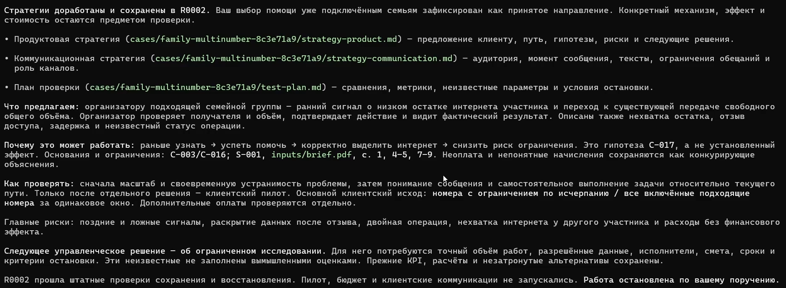
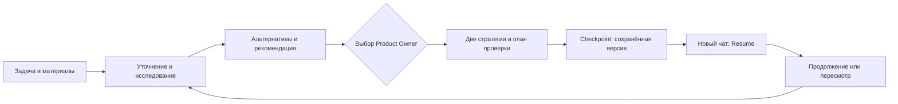

# Стратег Фабрики продуктов

**Из неопределённой бизнес-задачи — в обоснованный выбор, две стратегии и план проверки.**

Файловый ИИ-агент для руководителя цифрового продукта. Вы описываете задачу обычным языком; агент уточняет существенные вопросы, исследует разрешённые материалы и сравнивает варианты. Направление выбираете вы. Решение и его основания сохраняются в папке, к которой можно вернуться в новом чате.

**MGIMO AI Challenge · МегаФон · «Стратег Фабрики продуктов»**

[**Смотреть видео**](https://drive.google.com/file/d/1kDBIVW_hgRwh2WnttYouUtfnlhtD27P_/view) · [**Открыть результат**](docs/video-e2e.md) · [**Быстрый запуск**](docs/quickstart.md) · [**Архитектура**](docs/architecture.md)

[Описание для жюри](docs/submission-description.md) · [Четыре критерия и проверки релиза](docs/release/final-20261122/README.md)

| Проверяемый результат | Открыть | Граница доказательства |
|---|---|---|
| Основной видеокейс МегаФона | [Две стратегии и история D0001–D0003](cases/family-multinumber-video/README.md) | Учебный бриф; видео и новый чат подтверждены владельцем |
| LinguaStep: бриф, CSV, сайт, пять альтернатив и выбор PO B | [Продуктовая](cases/linguastep-retention/strategy-product.md) · [Коммуникационная](cases/linguastep-retention/strategy-communication.md) · [План](cases/linguastep-retention/test-plan.md) | Privacy-safe D0001 — производная исходного R0001 с новыми hashes |
| Resume исходного LinguaStep в новом чате | [Ограниченный transcript receipt](docs/release/final-20261122/source-resume-receipt.json) | Подтверждён владельцем; не полный подписанный platform export |
| Целостность экспортированного D0001 | [Gate, classify и inventory](docs/release/final-20261122/README.md#actual-exported-byte-checks) | Проверка новых байтов, не новый live E2E |

От обычного чата агент отличается сохранением проверяемых оснований, решений и ревизий. [Историческое сравнение F9](research/sol-audit/eval-results/F9-resume-comparison-20261113.md) показывает различие сохранённых артефактов; преимущество точности, скорости или стоимости не доказано. Cursor E2E, реальный retention-эффект и полная стоимость остаются непроверенными/UNKNOWN.



Кадр реального видео, 06:34: результат **до** критического пересмотра. [Источник и безопасный кроп](docs/assets/README.md); актуальные стратегии — ниже.

## Когда полезен агент

| Задача руководителя | Что остаётся после работы |
|---|---|
| Материалов много, но непонятно, какую проблему решать | Источники, проверенные сведения, гипотезы и существенные пробелы |
| Нужно выбрать между разными направлениями | Сравнение альтернатив, возражения и условия смены приоритета |
| Нужны согласованные продукт и коммуникация | Продуктовая и коммуникационная стратегии с общим механизмом ценности |
| Прежде чем запускать, нужно понять, что проверить | План проверки пользы, экономики и рисков |
| Обсуждение прервалось или появились сомнения | Восстановление сохранённого решения и пересмотр с историей |

От одноразового ответа модели отличается **организацией работы и сохранением оснований**: источники связаны с выводами, выбор человека отделён от рекомендации, прежние версии доступны. Это не доказательство превосходства качества или скорости над обычным чатом.

## Реальный E2E из видеозаписи

В учебном брифе «Связь для близких и собственных устройств» руководителю нужно выбрать первый приоритет: помощь семьям или владельцам нескольких номеров.

В записанном запуске агент изучил 11-страничный PDF, сравнил шесть альтернатив и после выбора Product Owner подготовил две стратегии. Затем дело восстановили в новом чате и критически пересмотрели финансовые выводы. Направление помощи уже подключённым семьям сохранено; достаточных оснований обещать финансовую цель нет.

[**Продуктовая стратегия**](cases/family-multinumber-video/strategy-product.md) · [**Коммуникационная стратегия**](cases/family-multinumber-video/strategy-communication.md) · [Решение](cases/family-multinumber-video/decision.md) · [Шесть альтернатив](cases/family-multinumber-video/options.md) · [План проверки](cases/family-multinumber-video/test-plan.md)

[Маршрут по этапам видео](docs/video-e2e.md) связывает PDF, выбор PO, стратегии до пересмотра и итог R0003. В GitHub опубликована обезличенная производная история **D0001–D0003**, не исходные R-байты. Видео и успешный Resume описаны владельцем; **9:58 — сообщённая им длительность**, а не независимый замер. Сам кейс учебный, не данные клиентов МегаФона.

## Быстрый старт

Нужны **Codex или Cursor**, доступ к выбранной модели и **Python 3.12+** для файловых helpers. Отдельный сервер, веб-приложение и Docker не нужны.

Для установленного Codex CLI:

```sh
git clone https://github.com/EdYaRdx/megafon_hack.git
cd megafon_hack
codex
```

Или откройте распакованную папку в VS Code с Codex / в Cursor. Напишите:

> Прочитай AGENTS.md и prompts/first-run.md. Пользователи бросают регистрацию. Помоги понять причины, сравнить варианты и выбрать, что улучшить. Сначала предложи папку нового дела и уточни только существенные вопросы.

Подтвердите предложенный путь. Агент создаст отдельное дело; материалы и результаты будут сохраняться в нём. Для продолжения в новом чате укажите точный путь: `RESUME CASE cases/<ваше-дело>`.

[Пошаговый запуск, продолжение и помощь с Python](docs/quickstart.md).

## Как устроена работа



**Product Owner** выбирает направление и утверждает существенные действия. Выбор стратегии не разрешает автоматически пилот, расходы или контакт с клиентами. **Checkpoint** связывает сохранённую версию с её файлами; Resume сначала проверяет эту связь, затем восстанавливает решение. История не заменяется новым ответом.

## Что находится в репозитории

Coding assistant предоставляет модель, чтение и запись файлов, поиск и выполнение команд в пределах разрешений среды. Репозиторий задаёт процесс, шесть Skills, формат дела и Python-проверки состояния.

| Компонент | Назначение |
|---|---|
| [Шесть Skills](.agents/skills/) | Intake → evidence research → options/decision → стратегии → experiment design → resume/revise |
| [Инструкция первого запуска](prompts/first-run.md) | Создание нового дела или выбор существующего |
| [Шаблон дела](cases/_template/README.md) | Источники, evidence, claims, решение и история |
| [Основной видеокейс](docs/video-e2e.md) | Реальный пример работы на учебном брифе |

[Архитектура и границы компонентов](docs/architecture.md) · [Документация](docs/README.md).

## Проверенные возможности и ограничения

- Опубликованы две стратегии, сравнение шести альтернатив, выбор человека и критический пересмотр с сохранёнными основаниями.
- Файловые проверки подтвердили checkpoint, восстановление перенесённой копии и воспроизводимость расчётов. [Результаты и область проверок](docs/evaluation.md).
- Доступность сайтов, PDF-инструментов и обнаружение Skills зависят от coding assistant и его разрешений. Инструкции не являются песочницей.
- Учебный E2E не подтверждает спрос, прибыль, полную автономность или одинаковую работу на всех hosts. Точная модель и полная стоимость записанного запуска не установлены.
- Используйте только разрешённые материалы, без секретов и закрытых клиентских данных. Содержание записи и доступ к конкурсным материалам проверяет владелец.

[Описание решения для жюри](docs/submission-description.md) · [Как ориентироваться в проекте](docs/repository-guide.md).
