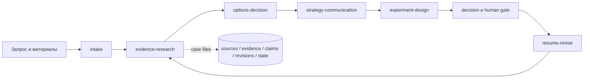

# Стратег Фабрики продуктов

**Файловый AI-агент для продуктовых решений:** от размытого запроса и разрозненных материалов — к проверяемым основаниям, вариантам и согласованным продуктовой и коммуникационной стратегиям. Это переносимая папка проекта с инструкциями, шестью Skills, шаблоном дела и журналами; не отдельное приложение или сервис.

## Что делает агент

Агент помогает уточнить решение и его границы, исследовать разрешённые материалы, связать источники с утверждениями и неизвестным, сравнить варианты, сформировать рекомендацию и план проверки. После паузы он продолжает работу по сохранённым файлам и пересматривает выводы при новых данных. Человек сохраняет решение о существенных действиях.

В отличие от обычного чата, результат сохраняется как структурированное дело с проверяемыми связями и историей ревизий, а не только как ответ в переписке. Возможности: точные source locators; раздельные статусы доказательств; минимум три содержательно разных варианта, включая статус-кво и остановку; связанные стратегии продукта и коммуникации; метрики с comparator, знаменателями, периодом и guardrails; сохранение ревизий, оснований и состояния.

## Быстрый старт

Требуется совместимый coding assistant с доступом к папке и созданию/редактированию файлов. Модель, доступ к сайтам, локальным файлам, расчётным инструментам и обнаружение Skills зависят от host. В репозитории нет обязательного runtime, сервера, базы данных, MCP или установки пакетов.

1. Откройте корень репозитория в coding assistant.
2. Прочитайте [`AGENTS.md`](AGENTS.md), затем [`docs/quickstart.md`](docs/quickstart.md).
3. Скопируйте [`cases/_template/`](cases/_template/) в новый каталог `cases/<case-id>/`; заполните `brief.md` известным и отметьте неизвестное.
4. Следуйте [`prompts/first-run.md`](prompts/first-run.md) и сохраняйте работу только в новом деле.

**OMP не требуется для использования продукта.** Не запускайте `start-overnight-product-research-v3.cmd`: это исторический development/research launcher.

## Пример результата

В [`cases/meal-planner-demo/`](cases/meal-planner-demo/) содержится синтетический пример гипотетической функции планирования ужинов. Его CSV — вымышленные агрегаты, не оценка спроса; методическая веб-страница не доказывает потребность в продукте. Дело показывает источники и locators, evidence и claims, варианты, decision, две стратегии, test plan, activity и state. Это подготовленный кейс, не live-run и не данные МегаФона.

**Иллюстрация решения:** в синтетическом CSV указано 120 приглашённых, 24 ответа и 15 кликов. Это 24/120 = 20% ответов, 15/24 = 62,5% кликов среди ответивших и 15/120 = 12,5% от приглашённых. Набор неслучайный, формулировка вопроса неизвестна; эти доли не доказывают спрос. Поэтому synthetic case рекомендует не запускать платную функцию по этим данным, а рассматривать ограниченное исследование проблемы только после human approval; сохранить status quo и закрытие направления как альтернативы. Это иллюстрация зафиксированного дела, не новая проверка и не одобренное решение.

| Артефакт дела | Для чего |
|---|---|
| `sources.jsonl`, `evidence.jsonl` | Источники, точные locators, извлечённые сведения и ограничения |
| `claims.jsonl` | Утверждения, типы/статусы и связи с evidence |
| `options.md`, `decision.md` | Альтернативы, сильные возражения и условное решение |
| `strategy-product.md`, `strategy-communication.md` | Согласованные аудитория, ценность, обещание и каналы |
| `test-plan.md` | Comparator, метрика/знаменатель, период, guardrails и правило решения |
| `revisions/`, `ACTIVE.json`, `state.md`, `activity.jsonl`, `approvals.jsonl` | Полные снимки, выбор активной ревизии, продолжение и отдельные human approvals |

## Устройство и ограничения

Skills — файловые процедуры, а не работающий оркестратор. Папочная архитектура делает дело читаемым и переносимым без развёртывания сервиса, но фактические права, модель, инструменты, Skill discovery и соблюдение инструкций определяются host. Текстовые approvals — workflow gate, не техническое ограничение ОС или sandbox. См. [архитектуру и протокол](docs/architecture.md) и [ограничения и безопасность](references/security-and-source-handling.md).

## Статус

**Синтетический workflow; приёмка ограниченная и не завершена.** Динамический E2E имеет статус **CONDITIONAL** только в ограниченном single-host synthetic scope. Targeted F1–F5 **NOT ACCEPTED** из-за дефектов test harness/checker; F6 ограничен provenance. **H02 BLOCKED**; latest independent Sol acceptance sign-off **PENDING**. В рассмотренном scope подтверждённых product P0/P1 не найдено; это не полная security или release сертификация. Clean-host и cross-host portability не сертифицированы. Официальный демобриф МегаФона в доступных материалах отсутствует; это не доказывает, что организатор его не публиковал. Подробности и точные границы: [`docs/implementation-status.md`](docs/implementation-status.md) и [`docs/evaluation.md`](docs/evaluation.md).

## Документы и примеры

- [Документация](docs/README.md) · [Quick Start](docs/quickstart.md) · [Архитектура](docs/architecture.md)
- [Оценка и доказательства](docs/evaluation.md) · [Submission checklist](docs/submission-checklist.md)
- [Каталог кейсов](cases/README.md) · [Research/dev-only индекс](research/README.md)
- [Конкурсный бриф](docs/contest-brief.md) · [Лимиты и безопасность](references/security-and-source-handling.md)

## Для разработчиков и исследователей

`research/`, `.omp/` и `start-overnight-product-research-v3.cmd` относятся к разработке, аудиту и исследовательской истории, не к product runtime или первому запуску. См. [research index](research/README.md). Не запускайте legacy launcher как Quick Start; не публикуйте сырые сессии, секреты или личные данные.
