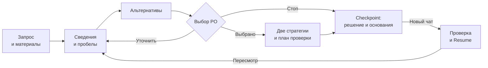

# Стратег Фабрики продуктов

**Помощник руководителя цифрового продукта: выбрать следующий шаг, обосновать его и продолжить работу после паузы.**

Нужно решить, что менять в продукте, но материалы разрознены, причины неясны, а одного убедительного ответа недостаточно: важно понять, **почему выбрать этот вариант и что проверить до запуска**.

Агент уточняет задачу, изучает доступные разрешённые источники, сопоставляет факты и возражения, сравнивает альтернативы и готовит **продуктовую и коммуникационную стратегии с планом проверки**. Направление выбираете вы.

**Результат — папка с решением и его основаниями**, а не только текст чата. Можно открыть источник важного вывода, посмотреть прежние решения и восстановить сохранённую версию в новом чате. Это файловый проект для Codex/Cursor, не отдельное приложение; модель и инструменты предоставляет ваша среда.

**Кейс из видеозаписи:** [помощь уже подключённым семьям](docs/video-e2e.md) — первый запрос, PDF, шесть альтернатив, выбор PO, две стратегии, Resume и критический пересмотр. Реальный запуск агента на **учебном** брифе; для публикации подготовлена отдельная обезличенная D-копия, не исходные R-байты.

*MGIMO AI Challenge · Трек МегаФона «Стратег Фабрики продуктов»*

[**Смотреть видеодемонстрацию**](https://drive.google.com/file/d/1kDBIVW_hgRwh2WnttYouUtfnlhtD27P_/view) · [**Результаты из видео**](docs/video-e2e.md) · [**Начать со своей задачи**](docs/quickstart.md) · [Прежний prepared demo](docs/contest-demo.md) · [Доказательства и ограничения](docs/evaluation.md) · [Навигация по ролям](docs/README.md)

## От вопроса к решению

**Кто за что отвечает:** модель исследует, сравнивает и пишет; **Product Owner (владелец продуктового решения)** выбирает направление и решает существенные вопросы. Выбор не разрешает пилот, расходы, публикацию или контакт с клиентами. Checkpoint — сохранённая версия с проверяемыми контрольными суммами; целостность файлов не доказывает качество стратегии или эффект.

## Быстрый старт

Нужны локальная копия репозитория, coding assistant с доступом к файлам и инструментам, доступ к модели; для штатного создания дела и проверки checkpoint нужен **Python 3.12+** и разрешённое выполнение команд (либо оператор, который выполнит их сам). Устанавливать сервер или поднимать Docker не нужно.

1. Получите [clone или полностью распакованный ZIP](docs/quickstart.md#0-получите-и-откройте-проект) и откройте корень в **Codex** или **Cursor**. Само открытие ничего не запускает.
2. Попросите ассистента прочитать [`AGENTS.md`](AGENTS.md) и [`prompts/first-run.md`](prompts/first-run.md).
3. Напишите обычным языком, например: **«Пользователи бросают регистрацию. Помоги понять причины и выбрать, что улучшить».**
4. Агент предложит **конкретный путь нового дела**. Подтвердите его перед созданием файлов; дальше агент задаст только важные вопросы и начнёт работу.

Для продолжения в новом чате укажите точный путь существующего дела: `RESUME CASE cases/<case-id>`. Не используйте восстановление «последнего» дела по догадке. [Пошаговая инструкция, Windows/Python fallback и ошибки](docs/quickstart.md).

## Реальный E2E из видеозаписи

[**Маршрут по этапам видео**](docs/video-e2e.md) · [Решение после R0003](cases/family-multinumber-video/decision.md) · [Продуктовая стратегия](cases/family-multinumber-video/strategy-product.md) · [Коммуникационная стратегия](cases/family-multinumber-video/strategy-communication.md) · [Шесть альтернатив](cases/family-multinumber-video/options.md) · [Исходный PDF](cases/family-multinumber-video/inputs/brief.pdf) · [Критический пересмотр R0003](cases/family-multinumber-video/research/D0003/review.md) · [План проверки](cases/family-multinumber-video/test-plan.md).

Длительность видео — **9:58 по сообщению владельца**; папка Google Drive имеет доступ по ссылке по его подтверждению. Содержательная проверка кадров и звука остаётся ответственностью владельца; доступ жюри не подтверждён этой проверкой. В [`cases/family-multinumber-video/`](cases/family-multinumber-video/README.md) — самостоятельная производная цепочка **D0001–D0003 от R0001–R0003** с [картой контрольных сумм](cases/family-multinumber-video/export-map.json). Результаты отделены от старого демо ниже. Направление B сохранено; достижимость 285 млн ₽, сроки и окупаемость `UNKNOWN`, пилот и бюджет не одобрены. [Аудит, проверки и решения владельца](docs/release/video-family-e2e-20261121.md).

## Прежняя подготовленная демонстрация: мобильный сервис

Мы проверяли агента на предоставленном для демонстрации **11-страничном примере брифа «Связь для близких и собственных устройств»** ([`Пример брифа.pdf`](cases/mobile-product-strategy-demo/inputs/Пример%20брифа.pdf)). Задача учебного оператора: сравнить помощь семьям и владельцам нескольких номеров, обосновать выбор, коммуникацию и экономику.

**Происхождение PDF:** владелец подтвердил 21.11.2026, что получил документ непосредственно со страницы задания MGIMO AI Challenge. Это подтверждение владельца, не независимая сверка версии и не отдельная лицензия на PDF. Учебные числа не являются данными МегаФона.

| Этап работы | Что показывает |
|---|---|
| **Исследование** — исходная R0001 | Шесть альтернатив, источники, сильные возражения и неизвестное |
| **Выбор Product Owner** — R0002 | Приоритет узкой проактивной помощи семье, но не разрешение пилота |
| **Пересмотр после независимого аудита** — R0003 | Исправление допущений, сценарии достижимости и сохранение `UNKNOWN` |
| **Доступная для просмотра копия** — D0001 → D0003 | Обезличенный производный кейс с **отдельной** цепочкой SHA-256, не исходные ревизии |

Восстановление **исходного** дела в новом чате успешно по наблюдению пользователя; это не повторённый независимый live E2E. Для D-копии отдельно проверялись файловые CLI-команды: [evidence и границы](docs/release/contest-rc-verification.md#воспроизведение-штатного-resume).

[**Разбор сквозного кейса**](docs/contest-demo.md) · [Продуктовая стратегия](cases/mobile-product-strategy-demo/strategy-product.md) · [Коммуникационная стратегия](cases/mobile-product-strategy-demo/strategy-communication.md) · [Пятичастный документ](cases/mobile-product-strategy-demo/strategy.md) · [Происхождение копии](cases/mobile-product-strategy-demo/EXPORT.md)

**Пример проверяемой экономики:** разрыв 279 → 285 млн ₽ при условных прямых затратах 1 млн ₽, нулевых других вкладах и ставке 500 ₽ за оплаченный номеро-месяц требует **14 000 дополнительных оплаченных номеро-месяцев**. Это **условие достижения цели, не подтверждённый прогноз**. Неизвестны частота проблем, платёжный эффект, бюджет и ресурсы. [Допущения и проверка расчётов](docs/contest-demo.md#существенные-расчёты--с-единицами-и-границами).

## Что находится в репозитории

| Путь | Назначение |
|---|---|
| [`AGENTS.md`](AGENTS.md) | Общие правила поведения агента и границы полномочий |
| [`.agents/skills/`](.agents/skills/) | Шесть повторяемых процедур — от Intake до Resume |
| [`references/`](references/) | Методика источников, метрик и безопасности |
| [`cases/_template/`](cases/_template/) | Шаблон нового дела и протокол ревизий |
| [`cases/family-multinumber-video/`](cases/family-multinumber-video/README.md) | Обезличенная копия реального E2E из видеозаписи, отдельная D-цепочка |
| [`cases/mobile-product-strategy-demo/`](cases/mobile-product-strategy-demo/) | Прежний подготовленный демонстрационный кейс, сохранён без изменений |
| [`tools/`](tools/) и [`tests/`](tests/) | CLI-проверки, deterministic расчёты, тесты |
| [`docs/`](docs/README.md) | Руководства, архитектура, оценка и материалы подачи |
| [`research/`](research/README.md) | История разработки и аудитов: **не runtime** |

Остальные кейсы классифицированы в [каталоге](cases/README.md). [Карта репозитория и правила отбора файлов](docs/repository-guide.md) объясняют, что относится к продукту, демо, QA и архиву. Внешние исследовательские CLI, OMP и другие control-plane инструменты **не обязательны для запуска агента**.

## Проверки и границы

- Дело хранит источники, доказательства, тезисы, альтернативы, решения и ревизии. Проверки SHA-256 подтверждают согласованность сохранённого состояния, **не качество стратегии**.
- Работа с сайтами, PDF, таблицами, медиа и обнаружение Skills зависят от возможностей и разрешений выбранного coding assistant; нельзя приписывать недоступные функции самому репозиторию.
- [Результаты тестирования](docs/evaluation.md) · [Release verification](docs/release/contest-rc-verification.md) · [Сценарий демонстрационного видео](docs/demo-video-script.md) · [План реальных скриншотов и медиа](docs/demo-media-guide.md).
- **Публикация:** независимый аудит доступной Git-истории не выявил подтверждённых секретов; владелец допускает публикацию обычных исторических путей и Git author metadata. Обязательная очистка истории не требуется. Это не полная DLP-гарантия; [scope аудита, условия передачи и оставшиеся проверки](docs/submission-checklist.md#публикация-основного-репозитория).

Документы и примеры показывают границы подтверждённой работы. Они не доказывают спрос, прибыль, кросс-платформенную совместимость или полностью автономную работу без участия Product Owner.
