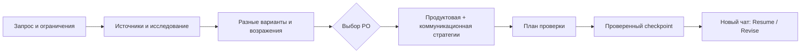

# Стратег Фабрики продуктов

**Из неоднозначной продуктовой задачи — в проверяемый выбор, две стратегии и план проверки.**

Для руководителя цифрового продукта, которому нужно решить, что делать дальше и на каких основаниях. Агент уточняет задачу, читает разрешённые материалы, сравнивает разные направления и сохраняет решение с источниками. Направление выбирает Product Owner.

[Смотреть реальное видео](https://drive.google.com/file/d/1kDBIVW_hgRwh2WnttYouUtfnlhtD27P_/view) · [За минуту для жюри](docs/for-jury.md) · [Карта возможностей](docs/capabilities.md) · [Подробный Quick Start](docs/quickstart.md)

**MGIMO AI Challenge · трек МегаФона.** Оба кейса учебные, реальные клиентские данные не использованы. Финальный PDF v4 ожидается в docs/MGIMO_FINAL_REPORT.pdf; [Markdown-описание решения](docs/submission-description.md) уже доступно. Старый PDF не выдаётся за v4.

## Быстрый старт

Нужны Codex с доступом к модели/файлам/командам и **Python 3.12+** для helpers. Отдельные сервер, Docker, база данных и новые MCP не требуются. Модель, разрешения и расходы предоставляет host; Cursor и другие среды требуют совместимых возможностей и отдельно не сертифицированы E2E.

Для установленного Codex CLI и доступа к репозиторию:

```sh
git clone https://github.com/EdYaRdx/megafon_hack.git
cd megafon_hack
codex
```

Или откройте папку в Codex. Напишите:

> Прочитай AGENTS.md и prompts/first-run.md. Пользователи бросают регистрацию. Помоги разобраться, сравнить направления и определить, что проверить. Сначала предложи отдельную папку дела и уточни существенные вопросы.

Подтвердите конкретный предложенный путь. Для продолжения в **новом чате** укажите: RESUME CASE cases/ваше-дело. [Создание, Python fallback и сохранение](docs/quickstart.md) описаны пошагово.

## Полный путь решения



Сначала подтверждаются источники и неизвестное, затем формируется рекомендация. Выбор направления не разрешает автоматически бюджет, пилот или контакт с людьми. Проверенный checkpoint связывает выбранную версию с файлами и SHA-256; старые основания остаются в истории.

## Два проверяемых кейса

| Кейс / исходная задача | Материалы | Две стратегии и проверка | Как проверить процесс |
|---|---|---|---|
| **МегаФон: семейный сервис.** Выбрать первый приоритет между помощью семье и собственными номерами | [Учебный PDF](cases/family-multinumber-video/inputs/brief.pdf), [шесть альтернатив](cases/family-multinumber-video/options.md) | [Продуктовая](cases/family-multinumber-video/strategy-product.md) · [Коммуникационная](cases/family-multinumber-video/strategy-communication.md) · [План](cases/family-multinumber-video/test-plan.md) | [Видео по этапам](docs/video-e2e.md), выбор PO, Resume и критический D0003 |
| **LinguaStep: retention.** Решить, что исследовать после падения агрегата при росте обоих сегментов | [Бриф](cases/linguastep-retention/inputs/brief-source.md), [CSV](cases/linguastep-retention/inputs/cohorts.csv), [методика](cases/linguastep-retention/sources/S-003-amplitude-text.txt), [пять альтернатив](cases/linguastep-retention/options.md) | [Продуктовая](cases/linguastep-retention/strategy-product.md) · [Коммуникационная](cases/linguastep-retention/strategy-communication.md) · [План](cases/linguastep-retention/test-plan.md) | [Настоящий Resume оригинала](docs/release/final-20261122/source-resume-receipt.json), [проверки экспортированного D0001](docs/release/final-20261122/README.md) |

Семейное видео и новый чат подтверждены владельцем. В Git — отдельная обезличенная история D0001–D0003, не исходные R-байты. Длительность 9:58 указана владельцем, не независимый замер.

LinguaStep прошёл модельный workflow на новой синтетической задаче, реальный выбор PO B, две стратегии, checkpoint R0001 и подтверждённый владельцем Resume нового чата. Receipt — ограниченная неподписанная транскрипция tool outputs. Здесь хранится privacy-safe **D0001 с новыми hashes**: [карта происхождения](cases/linguastep-retention/EXPORT.md) отделяет оригинальный E2E/Resume от CLI-проверок новых байтов. Дело первоначально создал оператор; свободный NEW целиком этим запуском не доказан.


Подлинный кадр 06:34, результат R0002 **до** пересмотра. [Источник и безопасный кроп](docs/assets/README.md).

## Что помогает проверить и продолжить решение

| Возможность | Польза для PO | Проверяемое основание |
|---|---|---|
| Шесть последовательных Skills | Не потерять этапы от Intake до проверки | [Skills, реализация и статусы](docs/capabilities.md#шесть-skills--одна-последовательность-шесть-процедур) |
| Источники → evidence → claims | Увидеть, на чём держится вывод и чего не знаем | [Правила и locators](references/evidence-and-claims.md), журналы обоих кейсов |
| Воспроизводимые расчёты | Различать проценты, числа, знаменатели и состав когорт | [Реальный CSV replay](docs/release/final-20261122/export-calculation-replay.json) |
| Отказы и fallback | Сохранить ошибку и восстановить работу доступным разрешённым инструментом | [Ошибки PDF/инструментов](docs/evaluation.md), [Python discovery](tools/find_python.ps1) |
| SHA-256, явная версия и история claims | Восстановить выбранное решение и не активировать случайный draft | [Checkpoint contract](cases/_template/README.md), [read-only inventory](tools/resume_context.py) |
| Критический пересмотр | Ослабить неподтверждённый вывод, сохранив прежнюю версию | [Что изменено в D0003](cases/family-multinumber-video/research/D0003/review.md) |

Полная [матрица возможностей](docs/capabilities.md) отмечает VERIFIED, IMPLEMENTED_NOT_E2E_TESTED, HOST_DEPENDENT и NOT_IMPLEMENTED. HELP и свободный NEW описаны с точными сценариями проверки; MCP/hooks/subagent runtime, мультимодельный router и background monitoring не заявлены.

## Архитектура без отдельного приложения

**Host (модель и инструменты) → AGENTS + шесть Skills → выбранное файловое дело → Python-проверки.**

Инструкции/методика, входные материалы и состояние дела хранятся раздельно. Модель исследует и пишет; Python создаёт папку и проверяет файловый протокол; PO выбирает направление и разрешает существенные действия. [Архитектура](docs/architecture.md) объясняет компоненты и границы. Инструкции не являются sandbox и не заменяют permissions host.

## Чем полезнее одноразового ответа чата

После обсуждения остаются источники, UNKNOWN, выбор человека, две стратегии и история ревизий. Их можно проверить, продолжить в новом чате или пересмотреть адресно.

[Сравнение F9](research/sol-audit/eval-results/F9-resume-comparison-20261113.md) подтверждает различия в сохранении артефактов. В нём один ответ на режим, разные file access/формы ответа и неизвестная стоимость; структурированный чат тоже получил высокие оценки. Превосходство по точности, скорости или цене не доказано.

## Выполненные проверки и пределы

| Проверка | Фактический результат |
|---|---|
| Windows / Python3.12.14 | [121 тест, 0 failures/errors, 5 symlink-privilege skips](docs/release/final-20261122/unit-tests.json) |
| Ubuntu / Python3.12.16 | [121 тест, 0 failures/errors, 5 Windows-only skips](https://github.com/EdYaRdx/megafon_hack/actions/runs/45050094992); Windows symlink-проверки прошли на Ubuntu |
| Основной main после PR32 | [CI успешен](https://github.com/EdYaRdx/megafon_hack/actions/runs/45053791062); [актуальные запуски main](https://github.com/EdYaRdx/megafon_hack/actions?query=branch%3Amain) |
| Семейный D0003 и LinguaStep D0001 | [Штатные hash/gate/classify receipts](docs/release/final-20261122/README.md); оба экспортированных checkpoint проверены |
| Ссылки, syntax и текущая навигация | [Новая целевая проверка](docs/main-submission-checks.json) включает repository checker, оба checkpoint и scoped privacy scan; это проверка локальных targets, не доступов жюри |

Исследования, планы и учебная арифметика не доказывают спрос, прибыль, причинный эффект или готовность пилота. Полное время продуктового решения, model calls/tokens и прямая стоимость UNKNOWN. Произвольные PDF/XLSX, изображения, сеть, Skills discovery и переносимость зависят от host; Cursor E2E не выполнен. Реальных интервью и аудио/видеоанализа не было.

[Четыре критерия для жюри](docs/for-jury.md) · [Все возможности](docs/capabilities.md) · [Документация](docs/README.md) · [Доступы и публичная видимость](docs/publication-safety.md)
