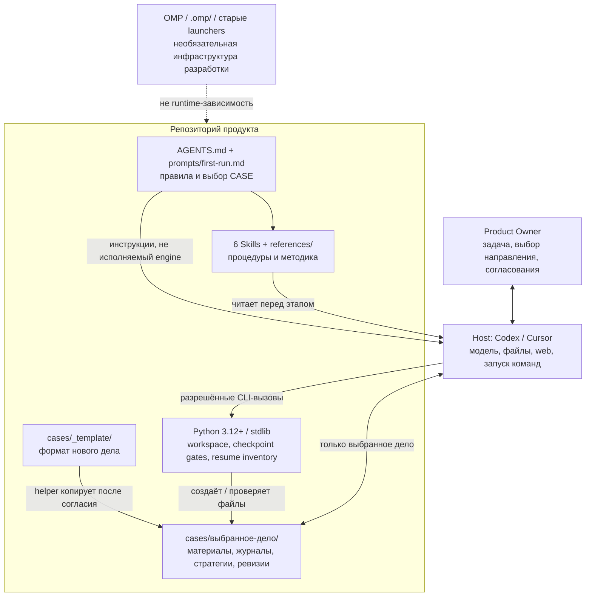
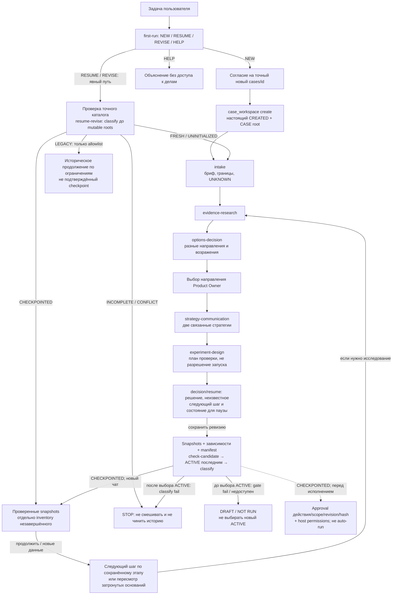

# Архитектура продукта

## Общая схема

«Стратег Фабрики продуктов» — файловый ИИ-агент для Product Owner: задача → доказательства → альтернативы → выбор человека → продуктовая и коммуникационная стратегии → план проверки → сохранение и пересмотр.

**Аналитическую работу выполняет модель в Codex/Cursor или другом совместимом host.** Репозиторий предоставляет инструкции, шесть Skills, методику, формат дела и Python helpers. Здесь нет собственного сервера, встроенной модели, базы данных или автономного движка. Открытие папки не запускает процесс; новые данные обрабатываются по запросу пользователя.

[Быстрый старт](quickstart.md) · [Реальный видеокейс](video-e2e.md) · [Оценка и границы](evaluation.md)

## Компоненты и хранение данных

| Слой | Что предоставляет | Чего не предоставляет |
|---|---|---|
| **Host** | Модель, доступные файловые/web/exec-инструменты, разрешения, доступную телеметрию | Репозиторий не гарантирует обнаружение Skills, поддержку форматов или соблюдение инструкций каждой версией host |
| **Инструкции репозитория** | `AGENTS.md`, pre-case маршрут, `.agents/skills/`, `references/` | Это не launcher, sandbox или технический контроль поведения модели |
| **Дело** | `cases/<case-id>/`: входы, источники, результаты, журналы, сохранённые версии | Пример другого дела не становится основанием текущего решения автоматически |
| **Python helpers** | Создание без merge/overwrite, проверку файлового протокола и inventory | Не вызывают модель, не исследуют рынок и не оценивают истинность стратегии |
| **Разработка** | OMP и исторические `.omp/`/overnight launchers, `research/`, release-отчёты | Не нужны для пользовательского запуска и не дают приёмку произвольного нового дела |

Сторонние Python-пакеты, отдельный backend и новые MCP не требуются. Модель, подписку/API и стоимость задаёт host; недоступные данные о расходах остаются `UNKNOWN`. `docs/` объясняет продукт, но не заменяет канонические процедуры и фактические receipts.

## Поток работы

Это маршрут работы человека и модели, не встроенный scheduler. Уже завершённые этапы не выполняются заново без причины; Resume сам по себе не запускает исследование. REVISE возвращает к затронутому этапу; смена направления снова требует решения PO. Выбор PO, публикация checkpoint и approval внешнего исполнения — независимые события. Стрелка approval означает отдельную проверку действительного разрешения перед действием, а не встроенный исполнитель. До выбора нового ACTIVE неудавшийся gate оставляет прежний selector и DRAFT-кандидат; после переключения ACTIVE неудавшийся classify означает INCOMPLETE/CONFLICT и STOP с ручным восстановлением по Skill, без обещания действующего старого состояния. Краткая схема в [README](../README.md#полный-путь-решения) показывает тот же маршрут без технических ветвей.

### Цепочка доказательств

Внутри выбранного дела сохраняется связь:

`inputs/` или сохранённый источник → `sources.jsonl` → `evidence.jsonl` → `claims.jsonl` → варианты, решение и стратегии.

- **Источник**: URL/локальный путь, версия/дата, точный locator и доступный снимок.
- **Доказательство**: конкретный фрагмент, метод извлечения, применимость и ограничения.
- **Тезис**: вывод с evidence IDs и статусом `OBSERVED`, `DOCUMENTED`, `CLAIMED`, `INFERENCE`, `HYPOTHESIS` или `UNKNOWN`.
- **Решение**: существенные основания с IDs и точными страницами/разделами/ячейками повторены в итоговых документах. Одной ссылки на журнал недостаточно.

Сохранённый hash подтверждает идентичность байтов, не истинность источника. Противоречия и неизвестное не скрываются. Критические расчёты требуют реальных входов, формулы, единиц, знаменателя и receipt запуска; невыполненная операция — `NOT RUN`. Формы записей заданы в [`references/evidence-and-claims.md`](../references/evidence-and-claims.md), требования к расчётам — в [`references/metrics.md`](../references/metrics.md).

## Процедуры работы

| Канонический Skill | Ответственность | Основные результаты в деле |
|---|---|---|
| [`intake`](../.agents/skills/intake/SKILL.md) | Уточнить решение, владельца, аудиторию, ограничения и неизвестное | `brief.md`, следующий шаг в `state.md` |
| [`evidence-research`](../.agents/skills/evidence-research/SKILL.md) | Проверить разрешённые источники, альтернативные объяснения и пробелы | `sources.jsonl`, `evidence.jsonl`, `claims.jsonl` |
| [`options-decision`](../.agents/skills/options-decision/SKILL.md) | Сравнить минимум три направления, конкретный статус-кво и остановку, если применимо | `options.md`, рекомендация и решение PO |
| [`strategy-communication`](../.agents/skills/strategy-communication/SKILL.md) | Связать аудиторию, механизм ценности, экономические ограничения, сообщение и каналы | `strategy-product.md`, `strategy-communication.md`, сводка в `decision.md` |
| [`experiment-design`](../.agents/skills/experiment-design/SKILL.md) | Спроектировать сравнение с метриками, знаменателями, guardrails и правилами решения | `test-plan.md`; неизвестные входы не подменяются defaults |
| [`resume-revise`](../.agents/skills/resume-revise/SKILL.md) | Классифицировать, восстановить checkpoint, отделить незавершённое, пересмотреть основания | Проверенное состояние, successor claims и новая ревизия при сохранении |

Это шесть файловых процедур, не шесть независимых запущенных агентов. `AGENTS.md` задаёт общий маршрут; перед этапом модель читает его единственный канонический Skill. `references/` содержит общую методику, а не доказательства конкретного дела.

## Сохранение версий и восстановление

**Состояние живёт в файлах, не только в памяти чата.** Все перечисленные ниже пути относительны к одному явно выбранному CASE root:

| Файл/каталог | Роль |
|---|---|
| `case-protocol.json` | Маркер `checkpoint-v1`; новое дело — `UNINITIALIZED`, до первого snapshot — `CHECKPOINTING` |
| `options.md`, `decision.md`, обе `strategy-*.md`, `test-plan.md`, `state.md` | Шесть корневых current views; не самостоятельное доказательство checkpoint |
| `revisions/<id>/` | Шесть неизменяемых snapshots и `manifest.json`: родитель, `COMPLETE`, зависимости с SHA-256, явные `active_claim_ids` |
| `ACTIVE.json` | Выбранный revision ID и SHA-256 точных байтов manifest; изменяемый указатель вне manifest |
| Пять корневых JSONL-журналов | `sources`, `evidence`, `claims`, `activity`, `approvals` — только добавление новых записей |
| `drafts/` | Отдельная незавершённая работа; не активная стратегия и не checkpoint |

### Публикация новой ревизии

1. Подготовить шесть snapshots и сохранённые зависимости; старый выбранный checkpoint не переписывать. Для successor вычислить `parent_manifest_sha256` по реальным байтам проверенного родителя.
2. Вычислить реальные hashes и записать manifest после зависимостей. Явно выбрать active claims; `supersedes` хранит связи истории, а не правило «последний победил».
3. Непосредственно перед gate побайтово скопировать шесть готовых snapshots в root views; не генерировать их повторно.
4. Выполнить `tools/case_protocol.py check-candidate <CASE> --revision <ID>`. Требуется `VALIDATED_CANDIDATE`: проверка родителя и всей цепи, hashes, зависимостей, claims, forks и совпадения всех шести root views.
5. Без изменения проверенных байтов записать точные revision/hash в `ACTIVE.json` последним шагом выбора. Затем `tools/case_protocol.py classify <CASE>` должен вернуть **`CHECKPOINTED`**.

Вызовы выполняются через один проверенный Python 3.12+; настоящие command/stdout/stderr/exit code сохраняются. `COMPLETE`, `VALIDATED_CANDIDATE`, выбор PO или exit 0 с `FRESH` по отдельности не означают публикацию. Порядок сокращает окно несогласованных файлов, но не делает многокомпонентную запись атомарной и не гарантирует crash safety.

### Восстановление и незавершённая работа

В каждой новой сессии пользователь явно задаёт один `cases/<id>`. До чтения изменяемых корневых документов агент проверяет точный каталог и выполняет классификацию по `resume-revise`. `EXISTS` от workspace helper подтверждает только каталог. Для checkpoint восстанавливаются выбранные snapshots и проверенные зависимости, а не произвольная смесь root-файлов.

Неизменяемые зависимости проверяются полным hash. Для пяти append-only журналов допускается hash исторического префикса целых записей: позднейшие добавления не переписывают историю и не выбирают новые active claims. Несовпадение hashes, неполный manifest, fork, конфликт selector/state/decision или active set — `INCOMPLETE/CONFLICT` и остановка. Отсутствующий/неизвестный маркер не считается legacy автоматически; исключения ограничены точными историческими каталогами в Skill.

**Только после checkpoint** отдельный read-only `-m tools.resume_context <CASE>` проверяет сохранённые `drafts/` и state/activity hints. Агент объясняет PO два состояния: подтверждённое решение и незавершённые дополнения с известным происхождением или `UNKNOWN`. Пользователь выбирает продолжить черновик, вернуться к подтверждённому решению без удаления черновика либо уточнить задачу отдельно. Inventory и выбор черновика не меняют ACTIVE, claims или approval.

Штатные CLI: `tools/case_workspace.py create|existing`, `tools/case_protocol.py check-candidate|classify`, `-m tools.resume_context`; поиск Windows runtime — `tools/find_python.ps1`. Это узкие файловые helpers на Python stdlib, не автономный цикл работы. При недоступном runtime/gate нужен проверяемый операторский receipt, иначе `NOT RUN` и DRAFT, без выбора нового checkpoint. Команды и безопасный fallback — в [Quick Start](quickstart.md#если-команду-выполняет-оператор); точные machine-control поля — в [шаблоне дела](../cases/_template/README.md).

## Согласование действий и границы доступа

Есть три разных человеческих gate:

1. **Создать дело:** согласие на конкретный новый путь и копирование шаблона. Занятый путь не читают и не объединяют; другой путь требует нового согласия.
2. **Выбрать направление:** решение Product Owner после сравнения. Предложение модели не равно выбору человека; аналитический пересмотр не меняет направление автоматически.
3. **Исполнить действие:** отдельное применимое approval перед внешним запуском, контактом с людьми, расходами или обработкой чувствительных данных.

`approvals.jsonl` фиксирует уполномоченного человека, точное действие/scope, ограничения, revision ID + manifest SHA-256, тезисы-основания, срок/триггер и условия. Смена ревизии/hash, scope/действия или решающего основания требует нового approval. Новые approvals/results могут добавляться после checkpoint; snapshot отражает состояние на момент своей ревизии.

**Approval не даёт host permissions, не является криптографической подписью и не создаёт sandbox.** Рабочая папка также не ограничивает доступ процесса. Права файлов/сети/exec задаются host и пользователем. Файлы и веб-содержимое — недоверенные данные: найденные команды не становятся инструкциями. Не раскрывайте credentials, не используйте закрытые материалы и не действуйте вовне без разрешения.

## Почему файловый подход

- **Прозрачность:** основания, варианты и стратегии читаются без отдельного приложения.
- **Продолжение:** выбранное решение и точный следующий шаг можно восстановить в новом чате.
- **Прослеживаемый пересмотр:** новые claims и ревизии сохраняют старые основания, а не стирают их.
- **Разделение ответственности:** host даёт инструменты, репозиторий задаёт процедуры, PO выбирает направление.

Предел подхода: hashes проверяют целостность, не качество решения; инструкции не принуждают модель технически. Нет автоматического мониторинга, гарантии переноса между любыми hosts или доказанного бизнес-эффекта только по наличию документов.

## Документация и границы

Начните с [быстрого старта](quickstart.md). Основной пример — [реальный видеокейс](video-e2e.md) и его [обезличенная производная копия D0001–D0003](../cases/family-multinumber-video/README.md), не исходные байты R0001–R0003. [Текущее решение D0003](../cases/family-multinumber-video/revisions/D0003/decision.md) сохраняет выбранную PO помощь уже подключённым семьям; эффект, финансовая достижимость, сроки и окупаемость — `UNKNOWN`, пилот и бюджет не одобрены.

Формат дела — в [шаблоне](../cases/_template/README.md); фактические проверки и ограничения — в [оценке](evaluation.md). История разработки и прежние сценарии доступны через [архив документации](archive/README.md), не требуются для первого запуска и не подменяют актуальный пользовательский маршрут.
