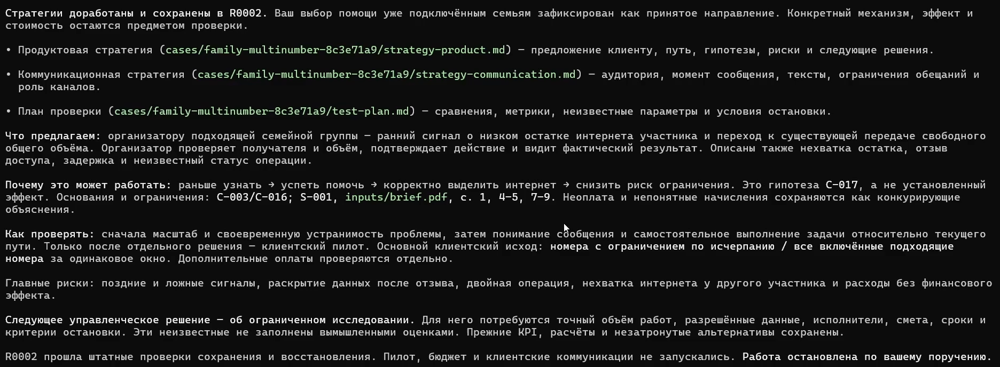

# Описание решения для жюри

## Ценность и аудитория

**«Стратег Фабрики продуктов» — файловый AI-агент для руководителя продукта (Product Owner).** Он помогает превратить неоднозначный вопрос в обоснованный выбор: материалы → проверяемые основания → разные альтернативы → решение человека → продуктовая и коммуникационная стратегии → план проверки. Результат — не только ответ чата, а папка дела с источниками, неизвестными и историей, которую можно продолжить в новом диалоге.

Ценность для PO — видеть, **на чём держится рекомендация, чего ещё не знаем и что нужно решить сейчас**. Это назначение продукта, а не доказанный рост прибыли, экономия времени или превосходство над обычным чатом.

**Основная демонстрация — реальная работа с агентом по учебному PDF-брифу:**

- [Видео в Google Drive](https://drive.google.com/file/d/1kDBIVW_hgRwh2WnttYouUtfnlhtD27P_/view) — **9:58 по сообщению владельца**, не независимо измеренная длительность.
- [Маршрут по результатам видео](video-e2e.md) и [дело `family-multinumber-video`](../cases/family-multinumber-video/README.md).
- [Продуктовая стратегия](../cases/family-multinumber-video/strategy-product.md), [коммуникационная стратегия](../cases/family-multinumber-video/strategy-communication.md) и [план проверки](../cases/family-multinumber-video/test-plan.md).

Владелец сообщает, что запись показывает естественную постановку, проверку шести Skills при первом входе, исследование 11-страничного PDF, шесть альтернатив, выбор PO, две стратегии R0002, Resume в новом чате и критический пересмотр R0003. Полный fresh-session E2E — его наблюдение; выборочные кадры и файловые проверки ниже имеют отдельный scope.

В репозитории — отдельная обезличенная история **D0001 → D0002 → D0003**, соответствующая исходным R0001–R0003, но не исходные байты. Оператор и показатели учебные; реальные клиентские данные МегаФона не использованы.



Кадр 06:34 показывает результат до критического пересмотра; применён только безопасный кроп. [Источник и преобразование](assets/README.md).

## Короткая проверка по ТЗ

Основание сопоставления — [предоставленный текст задания](contest-brief.md#обязательный-минимум), не независимая сверка кабинета организатора.

| Требование | Конкретный результат видеокейса | Граница доказательства |
|---|---|---|
| Постановка и материалы | [Запрос](../cases/family-multinumber-video/brief.md#запрос-пользователя), [scope](../cases/family-multinumber-video/inputs/user-scope.md), [PDF](../cases/family-multinumber-video/inputs/brief.pdf) | Учебные данные; получение этих байтов со страницы задания подтверждено владельцем, отдельная лицензия и независимая версия не установлены |
| Исследование документов, чисел и сайтов | [Разбор PDF](../cases/family-multinumber-video/sources/S-001-reading.md), [sources](../cases/family-multinumber-video/sources.jsonl), [evidence](../cases/family-multinumber-video/evidence.jsonl), [claims](../cases/family-multinumber-video/claims.jsonl) | Числа из PDF; GOV.UK/Stripe использованы как методика, не данные рынка или доказательство эффекта |
| Альтернативы и выбор человека | [Шесть вариантов D0001](../cases/family-multinumber-video/revisions/D0001/options.md), [дословный выбор PO](../cases/family-multinumber-video/inputs/user-choice-D0002.md) | Выбор B зафиксирован; он не доказывает превосходство и не разрешает пилот |
| Две связанные стратегии | [Продуктовая D0002](../cases/family-multinumber-video/revisions/D0002/strategy-product.md), [коммуникационная D0002](../cases/family-multinumber-video/revisions/D0002/strategy-communication.md), [актуальный test plan](../cases/family-multinumber-video/test-plan.md) | Документы сохранены; клиентские проверки и доставка сообщений не выполнены |
| Пауза и продолжение | [Исторический inventory перед пересмотром](../cases/family-multinumber-video/research/D0003/restore-inventory-receipt.json), [свежий release receipt](release/video-family-e2e-receipt.json) | Первый — преобразованная source history; второй — новый CLI proof, не ответ модели |
| Критический пересмотр | [Поручение PO](../cases/family-multinumber-video/inputs/user-review-D0003.md), [что изменилось](../cases/family-multinumber-video/research/D0003/review.md), [решение D0003](../cases/family-multinumber-video/revisions/D0003/decision.md) | Завершён desk-пересмотр без новых эмпирических данных |
| Прозрачность процесса и затрат | Разделы ниже; [activity A-001…A-053](../cases/family-multinumber-video/activity.jsonl), [release-проверки](release/video-family-e2e-20261121.md#фактическая-release-верификация) | Полная модельная телеметрия и стоимость UNKNOWN; неизвестное не приравнивается к нулю |

## Архитектура без отдельного приложения

Агент работает внутри coding assistant, например Codex или Cursor. **Host предоставляет модель, чтение/запись файлов, web и разрешённое выполнение команд.** Репозиторий не содержит встроенной модели, сервера, базы данных, веб-интерфейса, фонового мониторинга или автоматического выбора провайдера. Открытие папки ничего не запускает. OMP — инструмент разработки/упаковки, не runtime-зависимость.

| Компонент | Назначение |
|---|---|
| `AGENTS.md`, `prompts/first-run.md` | Правила работы, явный выбор нового или существующего дела |
| `.agents/skills/` | Шесть процедур: intake, evidence-research, options-decision, strategy-communication, experiment-design, resume-revise |
| `references/` | Общая методика; она не заменяет доказательства по конкретной задаче |
| `cases/_template/` | Структура для безопасного создания отдельного дела |
| `cases/<case-id>/` | Входы, источники, evidence/claims, варианты, решение, стратегии, план и состояние |
| `revisions/`, manifests, `ACTIVE.json`, журналы | Снимки, зависимости и выбранная версия; история вместо памяти чата |
| `tools/`, Python 3.12+ standard library | Вспомогательные файловые проверки и операции, не «модель мышления» |

**Фактическая среда:** на выборочном кадре видео видны Codex TUI и метка `GPT-6.1-Sol high`; версия host, provider/API model ID, billing и настройки полной сессии — `UNKNOWN`. UI-метка не устанавливает точную оплачиваемую модель. Исходные ledgers сохраняют `model: UNKNOWN`; наблюдение видео не переписывает их задним числом.

В сохранённой истории ([activity](../cases/family-multinumber-video/activity.jsonl), A-002…A-024, A-037…A-052) отражены реальные инструменты и попытки:

- файловые чтение/запись и `apply_patch`; штатные `case_workspace.py`, `case_protocol.py`, `tools.resume_context`;
- Python **3.12.14** для детерминированных расчётов и checkpoint-команд;
- Windows.Data.Pdf для рендера всех 11 страниц, `view_image` для визуального чтения, Windows.Media.Ocr ru как дополнительное извлечение с проверкой ячеек;
- web search/open для GOV.UK и Stripe; сохранены атрибутированные методические пересказы;
- неудачные CUA/native-app попытки и проверки наличия PDF-пакетов; установка ПО и вызов Stripe API не выполнялись.

Windows PDF/OCR — путь этого запуска, **не обязательная зависимость Python helpers и не универсальный PDF/XLSX-парсер продукта**. Доступ к форматам и сайтам зависит от host. Запуск и fallback оператора: [Quick Start](quickstart.md); компоненты: [архитектура](architecture.md#компоненты-и-хранение-данных).

## Процесс принятия решения

### NEW: естественный запрос и уточнение

Первый запрос [сохранён в brief](../cases/family-multinumber-video/brief.md#запрос-пользователя):

> «Мы хотим развивать сервис для семей и пользователей с несколькими номерами, но пока не понимаем, на ком сосредоточиться и что лучше предложить клиентам. Помоги разобарться и выбрать направление. У меня есть PDF-бриф с исходными данными».

После согласия на точный путь агент создал дело из шаблона. Пользователь уточнил: решать строго учебный кейс, не подменять показатели реальными, обозначать неизвестное, окончательный выбор оставить руководителю. Это [сохранённые вводные](../cases/family-multinumber-video/inputs/user-scope.md), не ретроспективно придуманный prompt. Пользователю не обязательно знать команду `NEW`.

В D0001 сохранены шесть направлений: **A — статус-кво; B — помощь уже подключённым семьям; C — собственные номера; D — начисления; E — общий кабинет; F — остановка инициативы**. Буквы относятся только к этому делу.

### Выбор PO и две стратегии

Ключевые фрагменты [дословного поручения](../cases/family-multinumber-video/inputs/user-choice-D0002.md):

> «Выбираю помощь уже подключённым семьям как приоритетное направление для дальнейшей проработки».
>
> «Пока это не разрешение на пилот, бюджет или запуск коммуникаций».
>
> «Доработай продуктовую и коммуникационную стратегии с учётом моего выбора».

D0002 связывает выбранный механизм с клиентским путём, сообщением, условиями прав/тарифа/остатка и проверкой гипотез. Пользовательский успех, разрешение участника и подтверждённое исполнение не подменяются рекламным сигналом. Агент сохраняет результат и останавливается, как поручил PO.

### Resume в новом чате

Успех fresh-session Resume исходного R0002 подтверждён владельцем; полный дословный prompt и raw session не опубликованы. Запрос Resume виден на выборочном кадре видео 410 s; исторический inventory показывает восстановление R0002 перед R0003. Для **текущей производной копии** воспроизводимый запрос, не цитата из видео:

```text
RESUME CASE cases/family-multinumber-video
Прочитай AGENTS.md, prompts/first-run.md, Skill resume-revise
и EXPORT.md выбранного дела. Восстанови D0003: решение, основания,
неизвестное и следующий шаг. Объясни activity hints.
Не начинай новое исследование и не меняй историю.
```

Точные read-only команды — в [маршруте видеокейса](video-e2e.md#read-only-проверка-и-продолжение). CLI inventory доказывает читаемость выбранных файлов, не успешность будущего ответа модели.

### REVISE: критика экономики

В [дословном поручении пересмотра](../cases/family-multinumber-video/inputs/user-review-D0003.md) PO спрашивает:

> «Достаточно ли оснований считать, что помощь семьям позволит достичь финансовых целей? Не слишком ли мы уверены в эффекте, сроках и реализуемости?»
>
> «Проверь прежние выводы, исправь необоснованные утверждения и покажи, что изменилось. Выбранное направление пока сохраняем, но пилот и бюджет не одобрены».

**D0003 сохраняет B, но ослабляет финансовые и календарные выводы.** Сценарий без эффекта больше нельзя читать как прогноз или гарантированный нижний предел; предварительный ресурс не гарантирует готовность к Q2; числа третьего года — проект ориентира, не доказанный минимум. Семейная помощь не закрывает автоматически привлечение и активацию новых групп. [Отчёт пересмотра](../cases/family-multinumber-video/research/D0003/review.md) сохраняет прежние версии и показывает изменённые основания.

Проверенная учебная арифметика: `GP = 279 000 000 + 500M + O − C`; до цели 285 млн ₽ нужно `500M + O − C ≥ 6 000 000`. **Только при условных C=O=0** требуется 12 000 дополнительных оплаченных номеро-месяцев, не семей и не респондентов. M/O могут быть отрицательными, разработка I учитывается отдельно. [Расчёт](../cases/family-multinumber-video/calculations/D0003/results.json) — граница, не прогноз спроса, эффекта или окупаемости.

Следующий шаг — рассмотреть с руководителем комплект D1 об ограниченной диагностике P0/P1. Scope, доступ, люди и смета требуют отдельного решения. **GP/эффект/окупаемость/сроки UNKNOWN; пилот и бюджет не одобрены.**

## Что обеспечивает сохранение

Источники → evidence → claims разделяют данные, выводы, гипотезы и решения человека. SHA-256 manifests закрепляют снимки и существенные зависимости, parent-chain — историю, `ACTIVE.json` — выбранную ревизию. `check-candidate = VALIDATED_CANDIDATE` предшествует выбору; настоящий `classify = CHECKPOINTED` подтверждает выбранное файловое состояние. Корневые current views должны соответствовать снимкам. Исправление claim добавляет successor, не переписывает прошлое.

В свежем release inventory выбран D0003, drafts/issues пусты. Hint по `activity.jsonl` оставлен видимым: A-050…A-053 добавлены после закреплённого префикса и описывают завершение, не автоматически выбранный новый draft.

Это **целостность и восстановимость файлов, не доказательство истинности стратегии**. Execution approvals проверяются отдельно по действию, scope, revision/hash; в видеокейсе `approvals.jsonl` пуст. Инструкции не выдают прав ОС/сети, не являются sandbox или криптографической подписью человека.

## Подтверждённые дополнительные возможности и ограничения

| Что проверено | Фактический результат и источник | Чего это не доказывает |
|---|---|---|
| Checkpoint и восстановление D-копии | `VALIDATED_CANDIDATE`, затем `CHECKPOINTED`; D0003 digest `10b175b51789466e0b4858ff58c609149dd75d478db321b04c2a843677520626`; [receipt](release/video-family-e2e-receipt.json) | Качество рекомендаций или приёмку host |
| Перенос без исходного checkout и `.git` | В relocated/ZIP-like копии тот же inventory; [отчёт](release/video-family-e2e-20261121.md#фактическая-release-верификация) | Cross-host model E2E |
| Детерминированная арифметика | Два replay на временной копии совпали с сохранёнными JSON; [receipt](release/video-family-e2e-receipt.json) | Причинный бизнес-эффект |
| Регрессии helpers, Windows / CPython 3.12.14 | 121 tests, 69.542 s, `OK (skipped=5)`, exit 0; пять skips связаны с symlink privileges; [release-отчёт](release/video-family-e2e-20261121.md#фактическая-release-верификация) | Human/product/security acceptance |
| Repository checker того release | PASS, 262 Markdown files и indexed case JSON/JSONL syntax; новые 30 JSON/JSONL разобраны отдельно | Валидность внешних URL, fragments и смысла |
| CI PR #30 | Unit tests + Repository checker: SUCCESS на `0f27bef`; [CI run](https://github.com/EdYaRdx/megafon_hack/actions/runs/44939925462) | Новый live запуск агента |
| Независимые static reviews упаковки | ReleasePackageReview: findings none; ReleasePrivacyReview: `[]`; [scope](release/video-family-e2e-20261121.md#фактическая-release-верификация) | Полную DLP или безопасность видео/PDF-парсера |

При release проверены неизменность 98 файлов исходного дела, 131 файла прежнего demo и 100 файлов derivative после checks. [EXPORT](../cases/family-multinumber-video/EXPORT.md) и [export-map](../cases/family-multinumber-video/export-map.json) объясняют обезличивание путей, собственные D hashes и 15 исторических ledger-prefix mappings. Source receipts — преобразованная история оригинала, не новые результаты на D-байтах. PDF/11 PNG/OCR сохранены побайтово. Неподписанные receipts не являются независимой аттестацией исполнения.

**Ошибки и повторы не скрыты:** [activity](../cases/family-multinumber-video/activity.jsonl), A-004…A-016, фиксирует ошибку кавычек/NameError при проверке PDF-зависимостей, недоступные PDF-пакеты, minimized-window CUA failures и неуспешный WinRT AsTask overload. Повтор через stdin исправил probe; WinRT reflection дал 11 страниц, затем выполнены визуальное чтение и OCR. A-042 фиксирует исправление потери draft metadata до публикации, не провал сохранённого checkpoint. При release системный `py -3.12` не имел рабочего `encodings`; использован уже установленный CPython 3.12.14, без установки и смены policy. Подробности: [release-отчёт](release/video-family-e2e-20261121.md#фактическая-release-верификация).

**Время и стоимость:** 9:58 — длительность ролика по владельцу, не длительность решения задачи; на выборочном кадре есть `speed x10`. Timestamps журналов и elapsed отдельных Python-команд не равны model compute или активному времени PO. Точная оплачиваемая модель, число вызовов, billed tokens, тариф, общая стоимость, общее/активное время и экономия относительно baseline — **UNKNOWN**. Телеметрия прежнего demo сюда не переносится; 69.542 s — время инженерного suite, не скорость агента.

**Роль человека:** предоставить разрешённый бриф; согласовать создание конкретного дела; уточнить scope; выбрать B; ограничить разрешённые действия; поручить критический пересмотр. Эти решения не являются независимой human acceptance. Файловая история не позволяет утверждать отсутствие любой другой операторской помощи. Подтверждение шести Skills владельцем не доказывает automatic activation на произвольном clean host.

Общие ограничения: реальный спрос, M/O/C/I, baseline/sample/пороги, смета и критический путь неизвестны; полевая проверка не проведена. Нет доказанного causal lift, сравнительного выигрыша над чатом, полной clean-host/cross-host квалификации или общей injection resistance. [Evaluation](evaluation.md) отделяет эти границы от исторических испытаний и их неизменённых FAIL.

## Материалы для передачи

Этот документ — содержательная основа отдельного jury PDF. Видео опубликовано; подлинный кадр доступен выше и в `docs/assets/`. Экспорт PDF выполняется по требованиям формы подачи, а не подменяется заявлением, что Markdown уже является PDF.

Владелец отдельно подтверждает полный безопасный просмотр записи, права передачи и доступ жюри к видео/репозиторию, экспортированный PDF, если он требуется, и финальную подачу. Дополнительных исходников для hero-screenshot не требуется: он получен из реального видео. Модельную/billing телеметрию можно добавить только по реальным данным; при её отсутствии сохраняется UNKNOWN. [Ручной checklist](submission-checklist.md).

Сообщение для жюри: **«Агент помогает принять и сохранить проверяемое решение — и ослабить его, когда оснований недостаточно».** Доказательство — конкретные результаты видеокейса; ключевой выбор и разрешение исполнения остаются за человеком.
