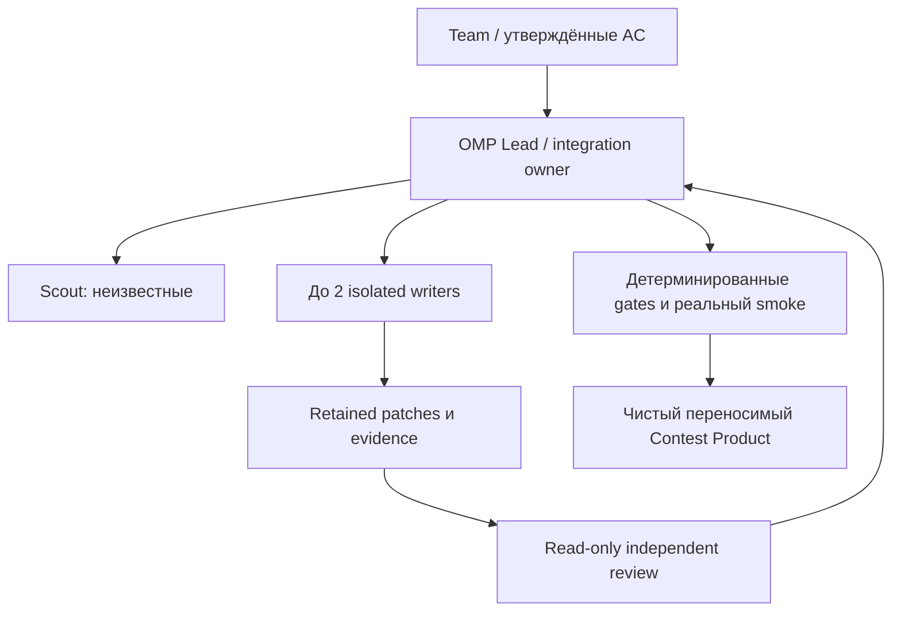

# Архитектурные варианты

Решение на 2026-11-10: **A — OMP-only**, bounded autonomous runs после qualification; до неё supervised execution. Основания DOCUMENTED в [harness findings](findings/a-harness.md), practically observed — только [local ledger](findings/local-environment.md). Не объявлять architecture production-ready.

## Разделение систем

Development System: OMP configs, model auth, sessions, optional skills, CI и evidence. Contest Product: только переносимые файлы/зависимости, требуемые будущим ТЗ; запуск и приёмка **без OMP/OpenClaw/OpenDesign/личных подписок**. Конкретный runtime, model contract и формат deliverable пока UNKNOWN до конкурсного ТЗ. Не подменять это разработкой runtime сейчас.

## A. OMP-only — выбран

- Один владелец orchestration и integration; native task/async/Hub/CLI/RPC.
- Сначала один writer. Два writers только после Windows isolation/merge PASS; задачи по независимым paths/interfaces.
- Один durable contract/task state, короткий handoff, JSONL/artifacts штатного harness; без SQLite board/собственного scheduler.
- Headless: `-p --mode json --wait-async --max-time`; нельзя считать один print invocation бесконечно работающим агентом.
- Межсемейный reviewer через Copilot только после entitlement/zero-overage gate. Сейчас доступен fresh-context same-family review, его ограничение явно фиксируется.

Риски: host rights, непроверенный isolation, recovery с unknown side effects, quota exhaustion. Меры — [configuration](omp-configuration.md), E01–E06/E09/E10. Если fails: supervised один writer, операторская интеграция; не маскировать fail новым framework.

## B. OpenClaw + OMP — отложен

Выгода **существенна только** для always-on remote channels, schedules и event-driven задания, которых сейчас не требуется. Для обычного продолжительного coding run OMP уже имеет async, persisted child sessions, monitoring и CLI/RPC; второй Gateway сам по себе не улучшает продукт.

DOCUMENTED: [Gateway](https://docs.openclaw.ai/concepts/architecture), [automation](https://docs.openclaw.ai/automation/cron-jobs/how-it-works), [ACP setup](https://docs.openclaw.ai/tools/acp-agents-setup). Реальная совместимость OMP/acpx/Gateway **UNKNOWN**. OMP имеет native `omp acp`; это не отсутствие adapter на стороне harness. Однако first-class `omp` target в прочитанных OpenClaw списках не найден. Pi target — другой проект.

Кандидат — custom acpx agent с Windows structured argv `["<absolute-path-to-omp.exe>","acp"]`, approved overlay и allowed-agent mapping. Версия OpenClaw release фиксирует acpx0.19.4; возможности moving main не обещать этому backend. Сторонний omp-acp RPC bridge не нужен при native ACP и добавляет translation/permission risks.

Ownership если B понадобится: OpenClaw принимает **одно внешнее задание**, OMP управляет внутренними workers; не nested OpenClaw→OMP→OpenClaw. Gateway admission не sandbox внешнего ACP процесса. Cancel/resume/result routing/model control и restart всех уровней должны пройти E08. Readiness/ACK не completion. Сохранённая сессия не доказывает живой process.

Условия перехода: реальный trigger/channel, назначенный владелец Gateway uptime/security, pinned versions, успешный E08/E10 и измеримый выигрыш в пропущенных/задержанных заданиях. Никаких установок ради гипотетического convenience.

## C. OpenClaw + DSH — не выбран

DSH developer preview с plugin/document workflows может быть полезен тимлиду, но это не основание мигрировать рабочий OMP. Canonical [DeepSeek Harness](https://www.deepseek.com/en/harness/) ведёт к [официальному source](https://github.com/deepseek-ai/deepseek-harness), release0.2.2-rc.1 — pre-release.

Точный ACP путь — `dsh --profile acp`; DSH session/resume и concurrent sessions документированы, session/load/fork/transcript replay отсутствуют. acpx main знает deepseek-harness, но его наличие в закреплённом OpenClaw backend не подтверждено. Профили/пермишены/плагины DSH нельзя механически заменить OMP настройками. Получим двойной lifecycle плюс preview churn без доказанного преимущества качества.

## D. OpenHands SDK / Canvas — условная альтернатива

Выбирать только когда Python/REST agent embedding, remote container workspaces или multi-user developer UI становятся **обязательным** development requirement. Это замена части runtime, не MCP-добавка к каждому OMP task. SDK Python≥3.12, Canvas Node≥24+uv; Windows multi-container runtime требует WSL2/Docker integration. Сейчас engine и рабочий Python не проверены. [Sources](findings/a-harness.md#openhands-актуальная-альтернатива).

## Что взять из прежней платформы

Public URL сейчас 404; локальный checkout позволил изучить source, не запускать. Сохранить: snapshot-bound acceptance, model claims≠evidence, explicit blockers/budgets, independent verification, unknown outcome≠success. **Не переносить:** custom controller/board/journals/MXC/D4/F2/Proof Pack. Отсутствующий qualification attestation и один исторический supervised pilot не доказательство готовой автономной системы.

## Критерий остановки инфраструктурной работы

E01–E06, E09 и E10 PASS в выбранном режиме; один full qualification slice прошёл на clean baseline, recovered interruption не потерял correctness, расходы наблюдаемы, release проверяется без Development System. После этого перейти к конкурсному ТЗ, не добавлять новые orchestrators. E07/E08/optional tools не блокируют baseline, если потребность не подтверждена.
